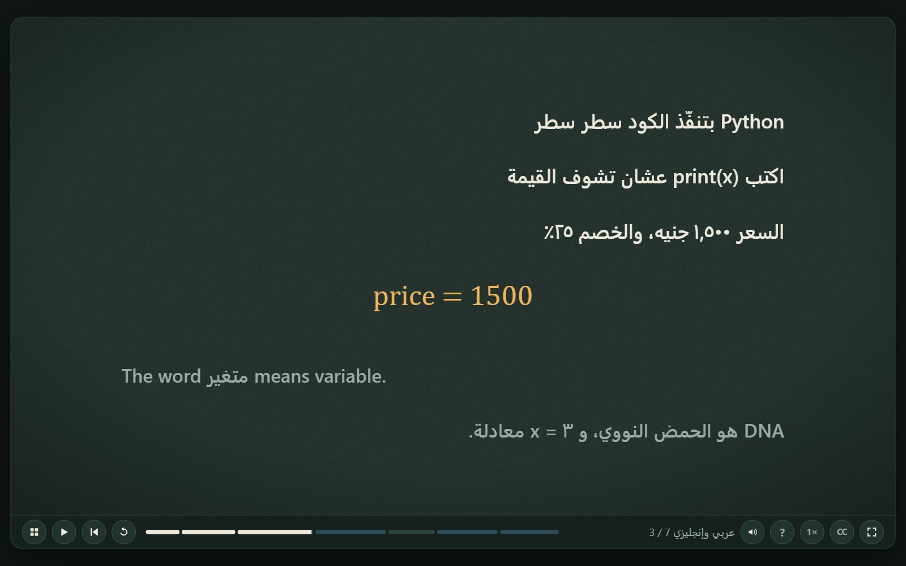

<div dir="rtl">

# ويزبوك (WizBook)

**كتب ويب بتتكلم وبتتحرك، وبالعربي كمان.** ويزبوك مهارة (Skill) لـ Claude Code من [أكاديميات الويزرد](https://github.com/wizard-academies): أكاديمية Code Wizards وأكاديمية MindWizard. بتاخد كتاب مدرسي PDF أو حكاية أو فكرة، وبتعملها كتاب تتفرج عليه وتسمعه وتجاوب فيه: دروس بأسئلة بتتصحح، وكتب مصورة، وأفلام وثائقية، وفيديوهات قصيرة للموبايل، وقصص بتتقلب بالسكرول، وخرايط بتتفسّح فيها.

[English ←](README.md)



*درس عربي قصير عن المتغيرات في Python، معمول بالمهارة لوحدها: بصوت Edge المصري، وفيه سؤال سريع اتجاوب بالأرقام العربي.*

ويزبوك مبني على **[Papermorph](https://github.com/DozenTwelve/Papermorph)** بتاع TedKaczynski، وبرخصته (MIT). Papermorph هو اللي عمل المحرك والقوالب والكتب المرجعية. ويزبوك زوّد **دعم العربي والكتابة من اليمين للشمال في كل القوالب**، واتراجع في تمن جولات مراجعة.

## ويزبوك زوّد إيه؟

الكتاب العربي كتاب كامل، مش كتاب إنجليزي اتبدلت حروفه:

- **الكلام بترتيبه الصح في كل حتة.** كل سطر على الشاشة، وفي الترجمة، وعلى الخريطة، وفي كروت القصة، وفي ملف الترجمة، بيتقري في اتجاه كلامه هو. يعني:
  - سطر عربي بيبدأ باسم إنجليزي (`Newton قال ذلك`) بيفضل يبدأ من اليمين.
  - جملة إنجليزي فيها كلمة عربي واحدة بتفضل من الشمال.
  - المعادلات زي `x = ٣` بتفضل زي ما هي.
  - ولو الأداة مش قادرة تحدد، المؤلف بيحط علامة اتجاه في أول السطر، وهي اللي بتحسم.
- **الإجابات اللي بتتكتب بالكيبورد العربي بتتصحح صح.** `٣` و`٠٫٧٥` و`١٬٠٠٠` و`١،٥` و`$١،٠٠٠` و`١،٠٠٠٫٥` بتتقري زي ما شكلها. وكل إجابة كانت بتتقبل قبل كده في كتاب إنجليزي أو روسي أو صيني أو ياباني، لسه بتتقبل بنفس الطريقة.
- **صوت عربي تقدر تثق فيه.** قسنا أصوات Edge العربي بنفسنا، ولقينا إن الصوت المصري **مش بينطق خالص** الرقم المكتوب كده `١٬٠٠٠` أو كده `١٫٥`، مع إن الترجمة بتعرضه. الأداة دلوقتي بتنبّه على كل رقم زي ده وبتقول يتكتب إزاي. وكمان بتعرف لو الصوت وقف قبل آخر الجملة، حتى لو الكلمة فيها تشكيل.
- **المعادلة جوه الجملة العربي بتفضل بترتيبها.** «لو 5 + x = 7» ما بقتش بتظهر «x = 7 + 5»، والاختيارين `x = 10` و`10 = x` ما بقوش شكلهم واحد، على الشاشة وفي الكروت وفي الترجمة. ومدى السنين والتاريخ والجمع بالأرقام العربي بيفضلوا يتقروا مع جملتهم.
- **الواجهة كلها عربي:** بالجمع العربي الصح، واختصارات الكيبورد شغالة على الكيبورد العربي، والمسافات بين الحروف والخط المايل بيتشالوا لأن الحروف العربي بتتوصل ببعض.
- **أمر واحد عشان تبدأ:** `python3 .claude/skills/wizbook/scripts/new_book.py lesson my-book --lang ar` بيعمل كتاب جديد من اليمين للشمال، بصوت عربي، وباللغة مكتوبة فيه.

## اتراجع إزاي؟

شغل العربي عدّى على **تمن جولات مراجعة**. في أغلب الجولات راجع الكود موديلين من شركتين مختلفتين، Gemini من جوجل وHunyuan من تينسنت، وفي الجولة الأولى Claude Fable، وفي التانية DeepSeek كمان. والجولة السادسة كان فيها تقرير واحد بس، تقرير تينسنت، لأن Gemini خلص وقته مرتين. وآخر جولة جت من إننا عملنا درس عربي بالمهارة واتفرجنا عليه مشهد مشهد: كده لقينا المعادلات المقلوبة. ولما المراجعين اختلفوا، رسمنا كل حالة في صفحة عربي قبل الإصلاح وبعده ([الصورة](docs/arabic-review/round8/before-after.png)). وكل واحد فيهم كان متطلب منه يدوّر على الغلط، مش يوافق وخلاص:

| | |
| --- | --- |
| ملاحظات اتفتحت واحدة واحدة واتحكم فيها | **١١٤** |
| اتقبلت واتصلحت | **٧١** |
| اترفضت، وكل واحدة سبب رفضها مكتوب | **٤٣** |
| مرات كسرنا فيها الكود بالقصد عشان نتأكد إن الاختبار الجديد بيمسك الغلط | **٦١ من ٦١ اتمسكوا** |

أحكام كل جولة، والتعليمات اللي اتدت للمراجعين، والسكريبتات اللي بتكسر الكود بالقصد، موجودين في [docs/arabic-review](docs/arabic-review/). ولما كانت الملاحظة بتعتمد على الصوت بيعمل إيه فعلًا، كنا بنقيس على Edge بدل ما نتناقش، وسكريبتات القياس موجودة هناك برضه.

وتغيير الاسم لويزبوك اتعمله [جولة مراجعة لوحده](docs/arabic-review/round7/ADJUDICATION.md)، ولقت إن الاختبار اللي بيتأكد إن الكتب الإنجليزي ما اتغيرتش كان بيتخطى نفسه من ساعة تغيير الاسم، ودلوقتي بيفشل بدل ما يسكت.

اللي ما اتجربش: الكتب ما اتشغلتش على Firefox ولا Safari.

## إزاي تبدأ؟

نزّل المهارة في مشروعك:

```bash
npx skills add wizard-academies/WizBook --skill wizbook --agent claude-code
```

وبعدين اكتب `/wizbook`. هيدوّر على ملف الـPDF في مشروعك (أو هيسألك عن الحكاية)، ويقولك نوع الكتاب، ويقترح فصل تبدأ بيه. ولو عايز الكتاب عربي، قوله.

محتاج: [uv](https://docs.astral.sh/uv/)، وffmpeg، ومتصفحات Playwright. الصوت ببلاش عن طريق Edge TTS.

## الحقوق والرخصة

ويزبوك نسخة معدّلة من [Papermorph](https://github.com/DozenTwelve/Papermorph)، وشايل محركه وقوالبه وسكريبتاته وكتبه المرجعية. الكتب اللي في `site/` بتاعة Papermorph. والاتنين تحت [رخصة MIT](LICENSE)، وفيها اسم أصحاب الحقوق الاتنين.

</div>
