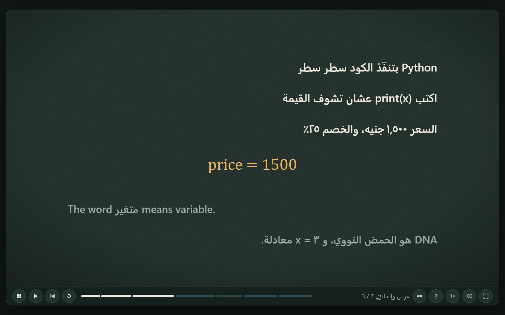

# WizBook

**Narrated, animated web books, in Arabic too.** A Claude Code Skill from [Wizard Academies](https://github.com/wizard-academies) (Code Wizards Academy and MindWizard Academy) that turns a textbook PDF, a story or an argument into a book you can watch, listen to and answer: lessons with graded questions, picture books, documentaries, upright shorts, scroll stories and maps you explore.

[بالعربي ←](README.ar.md)



*A short Arabic lesson on Python variables, made with the Skill alone: narrated by Edge's Egyptian voice, with a quick check answered in Arabic-Indic digits.*

WizBook is built on **[Papermorph](https://github.com/DozenTwelve/Papermorph)** by TedKaczynski, under its MIT licence. Papermorph made the engine, the kits and the reference books; WizBook adds **Arabic and right-to-left books across every kit**, checked over seven review rounds. The books on Papermorph's [live bookshelf](https://papermorph.diamonddoge.org/) show what the engine can do.

## What WizBook adds

An Arabic book is a whole book, not an English one with the letters swapped:

- **Text in the right order, everywhere.** Each line on the stage, in a caption, a map label, a scroll card or a subtitle reads in the direction of its own words. An Arabic line that opens with a Latin name (`Newton قال ذلك`) still starts at the right; an English sentence quoting one Arabic word stays left to right; `x = ٣` and `F = ma` are left alone. Where no rule can tell (`Sir Isaac Newton عالم إنجليزي`), the author decides with a direction mark at the start of the line.
- **Answers typed on an Arabic keyboard are graded right.** `٣`, `٠٫٧٥`, `١٬٠٠٠`, the comma key's `١،٠٠٠` and `١،٥`, `$١،٠٠٠` and `١،٠٠٠٫٥` are the numbers they look like, and every answer an English, Russian, Chinese or Japanese book accepted before is judged the same.
- **Arabic narration you can trust.** Edge's Arabic voices were measured: the Egyptian voice says *nothing* for a number written `١٬٠٠٠` or `١٫٥`, while the caption still shows it. `tts.py` names each such number and how to write it, and its check for a clip that stops before its text ends reads Arabic words without their vowel marks and numbers as Edge reports them.
- **Maths inside an Arabic sentence keeps its order.** `لو 5 + x = 7` no longer shows as `x = 7 + 5`, and the options `x = 10` and `10 = x` no longer look alike, on the stage, in cards and in captions; a range of years, a date or a sum in Arabic-Indic digits still reads with its sentence.
- **The interface in Arabic**, with Arabic plurals, keyboard shortcuts that work on an Arabic layout, letter spacing and italics dropped where Arabic letters join, and `.srt` subtitles marked so any player shows them in order.
- **One flag to start.** `python3 .claude/skills/wizbook/scripts/new_book.py lesson my-book --lang ar` writes `dir="rtl"`, an Arabic Edge voice and the language into a new book (Hebrew, Persian and Urdu pages open right to left too).

## How it was checked

The Arabic work went through **seven rounds of adversarial review**, each on a frozen commit, by models from other families than the author's: Google's Gemini and Tencent's Hunyuan in most rounds, with Anthropic's Claude Fable in the first and DeepSeek in the second. The sixth had one report, Tencent's, after Gemini ran out of time twice. The last round came from making an Arabic lesson with the Skill and watching it frame by frame: that is how the reversed equations were found, and where the reviewers disagreed, each case was drawn in an Arabic page before and after the fix ([the sheet](docs/arabic-review/round8/before-after.png)).

| | |
| --- | --- |
| Findings read by hand and ruled on | **96** |
| Accepted and fixed | **64** |
| Rejected, each with its reason written down | **32** |
| Deliberate breakages ("mutations") each new test had to catch | **58 of 58 caught** |

Every round's rulings, the brief the reviewers were given and the scripts that break the code on purpose are in [docs/arabic-review/](docs/arabic-review/) (in Arabic). Where a finding turned on what a voice actually does, it was measured against Edge rather than argued, and the measuring scripts are there too.

The rename to WizBook had [a round of its own](docs/arabic-review/round7/ADJUDICATION.md): it found that the check keeping English books unchanged had been skipping itself since the rename, and now fails instead.

What was not checked: the books have not been played in Firefox or Safari, and the full site check (`check_site.py`) runs in CI on a full checkout.

## Get started

Install the Skill in your project, for Claude Code or OpenCode:

```bash
npx skills add wizard-academies/WizBook --skill wizbook --agent claude-code   # or --agent opencode
```

Then type `/wizbook`. It finds the PDF in your project (or asks for your story), tells you what kind of book it is, suggests a chapter to try first and how much animation it needs, and offers a recommended option at every step. Your choices are saved in `style.json`, so every later chapter is made to the same style. For an Arabic book, say so, or start one with `python3 .claude/skills/wizbook/scripts/new_book.py lesson my-book --lang ar` (`picture`, `documentary`, `shorts`, `scroll` or `explore` in place of `lesson`).

In OpenCode, a clone of this repository already has the command (`.opencode/commands/wizbook.md`) and the Skill; with a global install, copy that file to `~/.config/opencode/commands/`.

You need [uv](https://docs.astral.sh/uv/), ffmpeg, and Playwright's browsers (`uv run --with playwright playwright install chromium firefox`). Narration uses Edge TTS (online) or Kokoro (local), free. A few steps are paid, optional and need an API key: acted ElevenLabs voices, clips made from a still ([OpenRouter](https://openrouter.ai/)), and painted sets for picture books (OpenRouter or OpenAI).

## How it works

A book is planned before it is drawn: chapters or scenes, then a script, then a storyboard. The narration is voiced and every word gets a time, and the picture is animated to those times. The model then watches its own output (contact sheets, overlap and blank-frame checks, end-to-end tests, a review against approved books) and fixes what it sees. Large chapters are made by a team of subagents ([core/team.md](.claude/skills/wizbook/references/core/team.md)).

Every book plays in the same player: pause anywhere, step back and forth, speed, captions, keyboard shortcuts and progress saved per book, with the interface in English, Russian, Chinese, Japanese or Arabic. The player lives in [`engine/`](engine) and every book keeps its own copy, so a book never breaks when the engine changes; `scripts/engine.py site` updates them from the engine release the Skill names (`DEFAULT` in `engine.py`) (`--from you/your-fork@main` from your own). A chapter also renders to a 1080p MP4 with an `.srt` (`scripts/export.py`), and a book can be packaged for an LMS as SCORM (`scripts/scorm.py`).

## Contributing

Fixes are welcome; start with [AGENTS.md](AGENTS.md). Please don't open pull requests that add a copyrighted book, its PDF, or lessons made from one. A fix to the engine or the kits that is not about WizBook itself may belong upstream in [Papermorph](https://github.com/DozenTwelve/Papermorph) too.

To try the examples locally:

```bash
git clone --depth 1 https://github.com/wizard-academies/WizBook.git
cd WizBook
python3 .claude/skills/wizbook/scripts/serve.py 8765 site   # then open http://localhost:8765/
```

## Credits and licence

WizBook is a modified version of [Papermorph](https://github.com/DozenTwelve/Papermorph) (MIT), whose engine, kits, scripts and reference books it keeps; the books under `site/` are Papermorph's. Both are under the [MIT licence](LICENSE), which names both copyright holders. The bundled MathJax (`engine/vendor/mathjax`) is under the Apache License 2.0. Pictures, recordings and data under `site/` keep their own licences, listed beside them (for example `site/pandemic/img/SOURCES.md`); toned copies of CC BY-SA pictures stay CC BY-SA.
